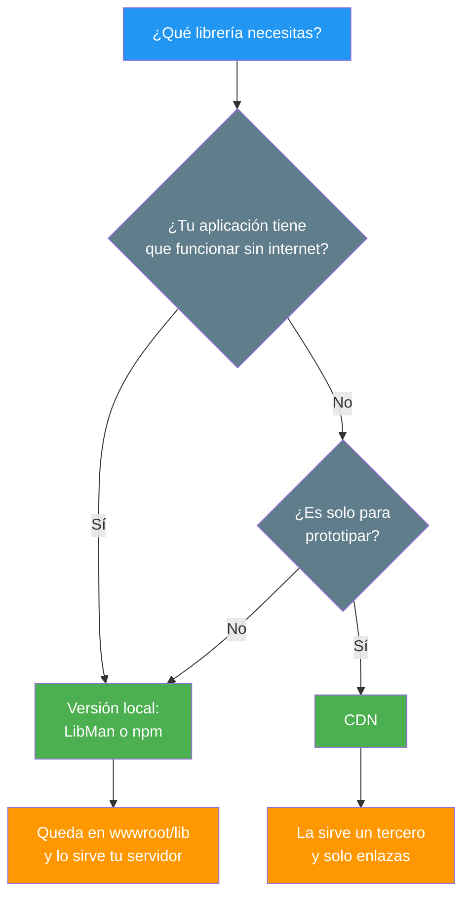

- [26. Recursos estáticos y librerías externas](#26-recursos-estáticos-y-librerías-externas)
  - [26.1. Lo que el navegador puede pedir](#261-lo-que-el-navegador-puede-pedir)
    - [26.1.1. La carpeta wwwroot, la única puerta](#2611-la-carpeta-wwwroot-la-única-puerta)
    - [26.1.2. Referenciar desde la raíz y la huella](#2612-referenciar-desde-la-raíz-y-la-huella)
  - [26.2. Las tres vías para traer una librería](#262-las-tres-vías-para-traer-una-librería)
    - [26.2.1. CDN: que lo sirva otro](#2621-cdn-que-lo-sirva-otro)
    - [26.2.2. LibMan: bajarla al proyecto](#2622-libman-bajarla-al-proyecto)
    - [26.2.3. npm y la copia manual](#2623-npm-y-la-copia-manual)
    - [26.2.4. Cuándo usar cada una](#2624-cuándo-usar-cada-una)
  - [26.3. Dónde va cada cosa](#263-dónde-va-cada-cosa)
    - [26.3.1. La carpeta wwwroot/lib](#2631-la-carpeta-wwwrootlib)
    - [26.3.2. Las carpetas css y js propias](#2632-las-carpetas-css-y-js-propias)
  - [26.4. Casos concretos](#264-casos-concretos)
    - [26.4.1. Bootstrap](#2641-bootstrap)
    - [26.4.2. Tailwind CSS](#2642-tailwind-css)
    - [26.4.3. Mapas de Google](#2643-mapas-de-google)
  - [26.5. Errores comunes](#265-errores-comunes)
  - [26.6. Buenas prácticas](#266-buenas-prácticas)
  - [26.7. Reto: el front-end de la tienda de Funkos](#267-reto-el-front-end-de-la-tienda-de-funkos)
    - [26.7.1. Contexto](#2671-contexto)
    - [26.7.2. Retos](#2672-retos)


# 26. Recursos estáticos y librerías externas

> 💡 **Punto de partida:** Estás montando la vista de tu tienda y un compañero te dice "ponte Bootstrap, que así queda en dos minutos". Copias un enlace de internet, lo pegas en el layout y la página se pone bonita. Al día siguiente abres el proyecto en el aula sin conexión y la página aparece sin estilo. La pregunta del tema es incómoda pero inevitable: cuando traes algo de fuera, ¿quién lo guarda, en qué carpeta y por qué ahí?

En este punto aprenderás a decidir cómo entra una librería externa en tu proyecto (CDN, LibMan o npm), dónde se guarda (`wwwroot/lib`, `wwwroot/css`, `wwwroot/js`) y cómo se referencia desde una vista, con los tres casos que usarás de verdad: Bootstrap, Tailwind y los mapas de Google.

**Objetivos de aprendizaje:**

- Entender qué puede servir tu servidor al navegador y por qué solo sale lo que hay en `wwwroot`
- Elegir entre CDN, LibMan y npm según el caso, y justificar la elección
- Colocar cada fichero en su carpeta y referenciarlo con `~` para que reciba la huella
- Montar Bootstrap, Tailwind y un mapa de Google sin dejar claves a la vista

📌 **Ejemplo real:** Netflix, cuando ves su página, descarga su CSS y sus scripts desde sus propios servidores, pero el reproductor de vídeo y ciertas librerías de terceros las pide a un CDN. En tu proyecto pasa lo mismo con Bootstrap: puedes pedírselo a un tercero (CDN) o guardártelo tú (`wwwroot/lib`), y la elección depende de si tu aplicación tiene que funcionar sin internet.

## 26.1. Lo que el navegador puede pedir

Cuando el navegador abre tu página, hace dos tipos de peticiones distintas y no conviene mezclarlas. Las vistas (`.cshtml`) se ejecutan en el servidor y devuelven HTML ya cocinado; los ficheros estáticos (CSS, JS, imágenes, fuentes) se sirven tal cual, sin tocarlos. Esta guía trata solo de esos segundos: dónde se guardan y cómo se traen.

Tu servidor no sirve "cualquier fichero del proyecto": sirve lo que haya en una carpeta concreta. Todo lo demás (`Pages/`, `Controllers/`, `appsettings.json`, tu código) está fuera del alcance del navegador, y eso es una decisión de seguridad, no una casualidad de la plantilla.

### 26.1.1. La carpeta wwwroot, la única puerta

`wwwroot` es la raíz pública del sitio: lo que hay dentro se sirve con su URL relativa y lo que está fuera no se sirve en absoluto. El punto de partida de cualquier proyecto la pinta en su árbol de carpetas, y el punto 16 la usa para las subidas; aquí nos basta con la regla.

```text
MiTienda/
├── Pages/                  ← aquí escribes tú (no se sirve)
├── Controllers/            ← aquí escribes tú (no se sirve)
├── appsettings.json        ← configuración (no se sirve)
├── Program.cs              ← arranque (no se sirve)
└── wwwroot/                ← lo único que sirve el servidor
    ├── css/site.css        ← tus estilos
    ├── js/site.js          ← tus scripts
    ├── lib/                ← librerías de terceros
    │   └── bootstrap/dist/css/bootstrap.min.css
    └── images/logo.png
```

En el arranque de la aplicación, `app.MapStaticAssets()` es la línea que enciende esa puerta y añade la huella a cada fichero, como viste en el punto 01.

> 📝 **Nota:** Si un fichero no está en `wwwroot`, su URL responde 404 aunque exista en el disco y aunque en el editor se vea perfecto. Es el error más frecuente de la unidad y ya lo viste en el punto 06.

### 26.1.2. Referenciar desde la raíz y la huella

Dentro de una vista, los recursos se escriben con `~`, que significa "desde la raíz del sitio". El servidor traduce esa ruta al final del renderizado y, de paso, le añade la huella al nombre del fichero.

```cshtml
<link rel="stylesheet" href="~/lib/bootstrap/dist/css/bootstrap.min.css" />
<script src="~/js/site.js"></script>
```

El navegador recibe `/lib/bootstrap/dist/css/bootstrap.min.abc123.css`: la misma carpeta, con un código en el medio que cambia solo cuando cambia el contenido, de forma que la caché no sirve una versión vieja. El detalle completo de la huella está en el apartado 6.3; aquí te queda la consecuencia práctica, que es la que usamos al referenciar librerías.

> 💡 **Consejo:** Si el recurso no recibe huella, casi siempre es por una de dos: la ruta no empieza por `~`, o el fichero no está donde dice la ruta. Mira las dos cosas antes de culpar al navegador.

## 26.2. Las tres vías para traer una librería

Hay tres formas de que una librería externa llegue a tu página y las tres se usan en proyectos reales. La diferencia está en quién guarda el fichero y quién lo sirve cuando alguien abre tu aplicación.



### 26.2.1. CDN: que lo sirva otro

Un CDN es un conjunto de servidores repartidos por el mundo que guardan copias de librerías públicas. Tú no descargas nada: solo pones un enlace en tu layout y el navegador baja la librería desde ahí. El punto 05 montó Bootstrap así en el `_Layout`, y el punto 21 lo vuelve a tocar desde el rendimiento.

```html
<link rel="stylesheet"
      href="https://cdn.jsdelivr.net/npm/bootstrap@5.3.3/dist/css/bootstrap.min.css" />
```

A favor: nada que guardar en el proyecto, actualizaciones cambiando el número de versión y descarga desde un servidor cercano al visitante. En contra: si no hay internet la página se queda sin estilo, no controlas la disponibilidad de un tercero y, en un ejercicio de examen sin red, es el modo de quedarse sin maquetación.

### 26.2.2. LibMan: bajarla al proyecto

LibMan es una herramienta de .NET que descarga librerías de front-end directamente en tu carpeta y anota qué ha bajado en un `libman.json`. Se instala como herramienta global y se usa desde la raíz del proyecto.

```bash
# Una sola vez en la máquina
dotnet tool install -g Microsoft.Web.LibraryManager.Cli

# Desde la raíz del proyecto .csproj
libman init --default-provider cdnjs
libman install bootstrap -d wwwroot/lib/bootstrap
```

El resultado es un `libman.json` en la raíz con la librería y su destino, y los ficheros ya colocados dentro de `wwwroot`. Quien clone el proyecto puede reconstruir esa carpeta con `libman restore`, así que el `libman.json` sí se sube al repositorio.

```json
{
  "version": "1.0",
  "defaultProvider": "cdnjs",
  "libraries": [
    { "library": "bootstrap@5.3.3", "destination": "wwwroot/lib/bootstrap" }
  ]
}
```

> 🔧 **Truco:** `libman update` sube todas las librerías anotadas a su última versión y vuelve a escribir el `libman.json`. Es el equivalente a "actualizar dependencias" sin salir del terminal.

### 26.2.3. npm y la copia manual

El gestor de paquetes de JavaScript es npm. Si tu proyecto ya pasa por Node (porque compila Tailwind o cualquier otra cosa), aquí también caben las librerías de estilos.

```bash
npm init -y
npm install bootstrap
```

Lo que baja npm se guarda en `node_modules`, que no está en `wwwroot` y por tanto no lo sirve el navegador. Hay dos salidas: copiar a mano los ficheros que necesitas dentro de `wwwroot/lib`, o añadir un paso de copia al script de build. Es la vía más potente y también la que más pasos tiene, por eso se reserva para cuando ya hay cadena de compilación en el proyecto.

La copia manual es lo que hacían los manuales antiguos: bajar un `.zip`, abrirlo y arrastrar el fichero a `wwwroot`. Funciona, pero nadie recuerda después qué versión tenía y no hay forma automática de actualizarla. Si la usas, deja anotada la versión en el nombre de la carpeta.

### 26.2.4. Cuándo usar cada una

| Criterio | CDN | LibMan | npm |
|---|---|---|---|
| Quién sirve el fichero | Un tercero | Tu servidor | Tu servidor |
| Funciona sin internet | No | Sí | Sí |
| Caché del navegador | Sí | Sí, con huella | Sí, con huella |
| Actualización | Cambias la versión del enlace | `libman update` | `npm update` y copia |
| Pesa en el repositorio | Nada | Solo `libman.json` | Hay que copiar a `wwwroot` |
| Cuándo conviene | Prototipos, demos y clases sin red | Librerías de producción sin cadena de build | Proyectos que ya usan npm |

📌 **Ejemplo real:** Amazon sirve su propio CSS desde sus servidores y usa CDN para las piezas genéricas que no cambian: si su CDN cae, la web sigue siendo comprable porque los ficheros críticos los sirve él. Esa misma lógica es la que aplicas cuando dejas Bootstrap en local y reservas el CDN para lo accesorio.

## 26.3. Dónde va cada cosa

La carpeta no es estética: decide quién sirve el fichero, si recibe huella y si se sube al repositorio. La regla es simple y no admite excepciones: dentro de `wwwroot` lo que es de terceros, fuera de `lib` lo que es tuyo.

### 26.3.1. La carpeta wwwroot/lib

`wwwroot/lib` es el sitio para lo que no has escrito tú: Bootstrap, jQuery, las librerías de mapas, cualquier cosa descargada. Cada librería lleva su propia subcarpeta con su nombre, y dentro se conserva la estructura que trae el proveedor (`dist/css`, `dist/js`), porque cambiarla solo genera dolores de cabeza al actualizar.

```text
wwwroot/
└── lib/
    ├── bootstrap/
    │   ├── dist/css/bootstrap.min.css
    │   └── dist/js/bootstrap.bundle.min.js
    └── jquery/
        └── dist/jquery.min.js
```

### 26.3.2. Las carpetas css y js propias

Tus estilos y tus scripts van en `wwwroot/css` y `wwwroot/js`, con nombres propios (`site.css`, `site.js`) que son los que ya trae la plantilla. Así separas lo tuyo de lo ajeno sin abrir ningún fichero: dos carpetas, dos significados.

```text
wwwroot/
├── css/site.css      ← tus reglas de estilo
├── js/site.js        ← tus funciones
└── lib/              ← lo que has traído de fuera
```

> ⚠️ **Advertencia:** Nunca mezcles: un `bootstrap-custom.css` propio no va dentro de `wwwroot/lib/bootstrap`, porque al actualizar la librería con `libman update` se borra. Lo propio va siempre fuera de `lib`.

## 26.4. Casos concretos

Estos son los tres que vas a usar en la práctica: el primero llega en un enlace, el segundo necesita compilar y el tercero lleva una clave que no puedes dejar a la vista.

### 26.4.1. Bootstrap

La vía rápida es el CDN, que es la que usa el punto 05 en el layout. La vía de producción es LibMan, que deja los ficheros en su sitio y anota la versión:

```bash
libman install bootstrap -d wwwroot/lib/bootstrap
```

Después solo cambia la línea del `<head>`: en vez de apuntar a internet, apuntas a tu carpeta y la huella se encarga del resto.

```cshtml
<link rel="stylesheet" href="~/lib/bootstrap/dist/css/bootstrap.min.css" />
<script src="~/lib/bootstrap/dist/js/bootstrap.bundle.min.js"></script>
```

> 💡 **Consejo:** El `bootstrap.bundle` ya lleva dentro Popper, que Bootstrap necesita para los desplegables. Si enlazas el fichero sin `bundle`, los tooltips y los menús no funcionan y la culpa parece de tu CSS.

### 26.4.2. Tailwind CSS

Tailwind es distinto: no se usa incluyendo un CSS ajeno, se genera un CSS tuyo a partir de las clases que escribes en las vistas. Hay dos formas de entrar.

Para probarlo en clase, su CDN de desarrollo hace el trabajo en el navegador sin instalar nada:

```html
<script src="https://cdn.tailwindcss.com"></script>
```

Para producción se compila: se instalan los paquetes con npm, se declara la entrada y el CLI escribe el CSS resultante en `wwwroot/css`, que es donde ya sabes que va lo tuyo.

```bash
npm install tailwindcss @tailwindcss/cli
```

```css
/* src/input.css: única línea necesaria en la versión 4 */
@import "tailwindcss";
```

```bash
npx @tailwindcss/cli -i ./src/input.css -o ./wwwroot/css/tailwind.css --watch
```

La salida de esa orden es un único `tailwind.css` con las utilidades que tu proyecto usa de verdad, listo para enlazar con `~` desde el layout. El `--watch` deja la terminal recompilando mientras escribes; sin él, la orden se ejecuta una vez y termina.

> ⚠️ **Advertencia:** El CDN de desarrollo de Tailwind está pensado para probar, no para publicar: añade tiempo de carga y compila en el navegador de quien te visita. En un ejercicio va bien, en producción se compila.

### 26.4.3. Mapas de Google

Un mapa de Google se mete con un script externo que lleva una clave de acceso. Esa clave se pide en la consola de Google Cloud, y conviene restringirla al dominio donde se va a usar, para que solo funcione en tu web.

```html
<script async src="https://maps.googleapis.com/maps/api/js?key=MI_CLAVE"></script>
```

La clave no se escribe a mano en la vista: se lee de la configuración. En desarrollo se guarda con User Secrets, como viste en el apartado 9 de la guía de comandos y en el punto 20, y en producción llega como variable de entorno.

```cshtml
@model TiendaModel

<script async
        src="https://maps.googleapis.com/maps/api/js?key=@Model.ClaveMapas">
</script>
```

```cshtml
<script async
        src="https://maps.googleapis.com/maps/api/js?key=@Model.ClaveMapas">
</script>
```

El PageModel solo expone lo que la vista necesita leer:

```csharp
public class TiendaModel(IConfiguration configuracion) : PageModel
{
    public string? ClaveMapas => configuracion["GoogleMaps:ApiKey"];
}
```

> 📝 **Nota:** Si la clave se te escapa al repositorio, Google la desactiva por uso indebido y el mapa deja de cargarse para todo el mundo. Restringirla por dominio y guardarla fuera del código son las dos mitades de la misma costumbre.

## 26.5. Errores comunes

| Error | Por qué ocurre | Cómo evitarlo |
|---|---|---|
| El recurso da 404 | No está en `wwwroot` o la ruta no coincide | Comprueba la carpeta y la escritura, minúsculas incluidas |
| La hoja de estilos no aplica | Se enlaza con ruta absoluta sin `~` | Escribe `~/css/site.css` en la vista |
| El navegador usa una versión vieja | Falta la huella | Usa `~` y sirve el fichero con `MapStaticAssets` |
| La página se queda sin estilo sin internet | Todo depende de un CDN | Deja las librerías críticas en `wwwroot/lib` |
| `libman restore` no encuentra nada | No está el `libman.json` o se ejecuta fuera del proyecto | Sube el `libman.json` y ejecuta desde la raíz |
| La librería desaparece al actualizar | Lo propio estaba dentro de `lib` | Mantén `lib` solo para terceros |
| El mapa no carga | Clave mal escrita, sin restringir o caducada | Reléela desde la configuración y revisa las restricciones |

## 26.6. Buenas prácticas

- **Decide antes de pegar:** elige CDN o versión local según si la app necesita funcionar sin internet, y deja la decisión escrita en el README del proyecto
- **`lib` es solo de terceros:** tus ficheros van a `wwwroot/css` y `wwwroot/js`, los de fuera a `wwwroot/lib/<nombre>`
- **Versiona las librerías:** anota la versión en `libman.json` o en el nombre de la carpeta, nunca "la última que había"
- **Sube el manifiesto:** el `libman.json` va al repositorio para que cualquiera reconstruya la carpeta con `libman restore`
- **Referencia siempre con `~`:** es lo que hace que el fichero reciba huella y la caché no se te quede vieja
- **Las claves no se escriben en las vistas:** se leen de la configuración y se restringen por dominio
- **Comprueba en el navegador:** abre las herramientas de desarrollo, pestaña red, y mira que el CSS responde 200 y no cae de un dominio que no controlas

## 26.7. Reto: el front-end de la tienda de Funkos

### 26.7.1. Contexto

La tienda de Funkos ya tiene vistas funcionando, pero se ve como una lista de enlaces: sin rejilla, sin botones y sin ficha de producto. El cliente quiere que se parezca a una tienda de verdad y que, además, se pueda ver en un mapa dónde está la tienda física. Tienes que decidir cómo entra el CSS y el mapa, dónde se guardan y qué pasa cuando abres el proyecto sin conexión.

### 26.7.2. Retos

- Elige Bootstrap y tráelo a `wwwroot/lib` con LibMan; después cambia el enlace del layout para que apunte a tu carpeta y comprueba en la pestaña de red que el CSS baja de tu servidor
- Deja también una opción por CDN comentada en el README, explicando en dos líneas por qué no la usas en producción
- Añade `wwwroot/css/site.css` con al menos tres reglas propias que sobrescriban estilos de Bootstrap y comprueba que la huella cambia cuando modificas el fichero
- Monta el mapa de la tienda con la clave de Google leída de la configuración, restringida al dominio del despliegue, y deja escrito en la memoria dónde guarda cada entorno esa clave
- Conéctate sin internet, reinicia la aplicación y anota qué se rompe y qué no; si algo crítico depende de un CDN, llévalo a `wwwroot/lib`

---

**Resumen del punto:**

| Concepto | Descripción |
|----------|-------------|
| **`wwwroot`** | La única carpeta que sirve el navegador; lo que está fuera no se pide |
| **`app.MapStaticAssets()`** | Enciende el servicio de ficheros estáticos y añade la huella |
| **Ruta `~`** | "Desde la raíz del sitio": el servidor la traduce y le pone huella |
| **CDN** | Un tercero sirve la librería: rápido y sin guardar nada, pero depende de la red |
| **LibMan** | Herramienta de .NET que baja librerías a `wwwroot/lib` y las anota en `libman.json` |
| **npm** | Gestor de paquetes de JavaScript; lo que baja va a `node_modules` y hay que copiarlo |
| **`wwwroot/lib`** | Carpeta de las librerías de terceros, una subcarpeta por librería |
| **`wwwroot/css` y `wwwroot/js`** | Los ficheros que escribes tú |
| **Huella** | Código en el nombre del fichero que cambia al cambiar el contenido |
| **User Secrets** | Dónde guarda la clave del mapa en desarrollo, fuera del repositorio |
| **Copia manual** | Funciona, pero deja el proyecto sin versionado ni actualización posible |

**¿Qué viene después?**

En el siguiente punto toca el Resumen de la unidad: repasar en una sola página todo lo que has montado desde la primera vista hasta el despliegue, con el mapa de conceptos y la checklist de supervivencia.
